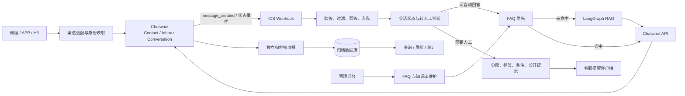

# ICS（Intelligent Customer Service）智能客服系统开发复盘

## 1. 复盘范围与结论

本项目从公司已部署的 Chatwoot 坐席平台出发，目标是把分散在微信、产品 APP（Android 和 iOS）中的客服入口，统一接入一套“AI 首接、人工兜底、过程可追踪、结果可统计”的智能客服系统。

项目没有重新开发一套坐席工作台，而是把 Chatwoot 保留为会话、联系人、Inbox、坐席工作台和基础分配能力的底座，在其外部增加 ICS 智能客服服务、渠道适配、提醒客户端、知识库管理、独立归档库、质检和统计模块。

截至本次复盘范围内，项目形成了两条完整交付线：

- **第一阶段，实际完成于 10 月 14 日**：打通 FAQ/RAG 自动问答、Chatwoot 跨系统联动、转人工、坐席分配、强提醒和多渠道接入的核心链路。
- **第二阶段，实际完成于 10 月 20 日**：补齐独立对话归档、后台查询与质检基础能力、坐席状态监管和统计报表模块。

整体架构已经从“Chatwoot 单独承接人工会话”演进为“Chatwoot 会话底座 + ICS 智能决策服务 + 独立数据与运营服务”。

## 2. 项目背景与接手状态

### 2.1 业务背景

公司存在多个产品渠道，需要为客户提供统一的咨询入口和一致的服务体验。原有客服接待方式存在以下问题：

- 渠道分散，客户信息和来源难以统一识别；
- 新客户进线提醒不明显，客服容易漏接或延迟响应；
- 坐席在线、小休、离线状态缺少统一管理；
- 客户无法稳定地按规则分配给可接待的客服；
- 会话记录、客服工作量和在线时长缺少统一统计；
- 缺少完整的对话归档和质检依据。

### 2.2 接手时的系统状态

接手时已经部署了 Chatwoot 坐席端，但实际存在多处与业务需求不符的功能问题，处于弃用和待改造状态。项目需要在不影响 Chatwoot 基础会话能力的前提下，重新建立一套满足客服方需求的 ICS 系统，并完成微信、产品 APP 等渠道接入。

客服方提出的需求可以分为两层：

| 层级 | 需求重点 |
| --- | --- |
| 客服功能实现层 | 微信和 APP 多渠道接入、用户属性获取、强弹窗提示、逐客户进线提醒、坐席状态管理、自动轮流分配、消息撤回、快捷回复快捷键 |
| 客服管理统计层 | 在线时长、询单量、聊天记录查询、质检、报表统计 |

## 3. Chatwoot 选型与二开原则

### 3.1 候选平台与评估方式

初筛候选为 Chatwoot 和 Frappe Helpdesk。评估方式采用本地部署和实际体验，重点验证会话流转、坐席工作台、渠道接入、分配、通知、联系人和统计能力是否能支撑第一阶段目标。

### 3.2 最终选择 Chatwoot 的原因

Chatwoot 与项目目标的匹配度最高：

1. **定位匹配**：原生定位就是开源客户沟通平台，已有会话、Inbox、联系人和坐席工作台。
2. **上线速度快**：账号、团队、坐席、会话、标签、快捷回复、附件和通知等基础能力可以直接复用。
3. **工作台成熟**：会话列表、分配、转接、内部备注、标签和团队协作已有可用界面。
4. **私有化可控**：客户资料、聊天记录和附件可以部署在自有服务器或内网。
5. **统计可扩展**：已有会话处理量、响应时间、解决时间和满意度等基础指标，细分绩效口径可通过归档和 BI 补充。
6. **扩展边界清晰**：Chatwoot 承担会话层和坐席操作层，业务画像、AI 知识库、绩效规则和质检放在外部服务。
7. **风险低于纯自研**：消息可靠性、权限、附件、通知、分配和多渠道适配等基础能力细碎且容易被低估，复用 Chatwoot 可以把研发精力集中在业务差异化部分。

### 3.3 非侵入式二次开发原则

项目最终采用“Chatwoot 做底座、ICS 做增强”的非侵入式方案：

- 通过 API 调用会话、标签、备注、状态、分配和公开消息能力；
- 通过 Webhook 接收消息和会话状态变化；
- 通过独立增强服务实现强提醒、AI 决策、归档、质检和统计；
- 通过渠道适配和 H5/Website Widget 接入微信及 APP；
- 尽量不修改 Chatwoot 核心源码，不把 Chatwoot 管理端 Token 暴露给前端。

这样做的核心收益是：Chatwoot 升级时，业务差异化代码不会与底座源码深度耦合，故障也可以按会话、AI、提醒、归档和统计模块分别定位。

## 4. 从 Chatwoot 基座到 ICS 的架构演进

### 4.1 初始基线：先盘点 Chatwoot 原生能力

第一步没有直接改造 Chatwoot，而是先验证原生能力和需求差距：

- 保留坐席在线、忙碌、离线状态切换；
- 使用 Inbox 和 Webhook 承接机器人业务逻辑；
- 验证 Round Robin 轮询分配；
- 复用基础联系人、会话和快捷回复；
- 通过 API/Webhook 获取用户 ID、昵称、来源渠道和会话事件；
- 通过独立服务补充新会话提醒、声音、浏览器通知、标签闪烁、统计、状态流水、质检和渠道消息适配。

盘点结论是：Chatwoot 适合作为人工会话和坐席操作底座，但无法直接覆盖 AI 首接、业务转人工规则、强提醒、客户画像归并、细粒度状态统计和业务口径报表。

### 4.2 目标架构

最终版的分层架构图已单独整理为：[ICS 最终版项目架构图](ics-final-architecture.md)；需要放大查看时可打开[可缩放版架构图](ics-final-architecture.html)。下方保留核心消息链路，便于在复盘正文中快速阅读。



消息处理路径采用以下顺序：

```text
用户消息
  -> Chatwoot Webhook
  -> 签名校验、入站过滤、幂等登记
  -> 后台队列和会话串行处理
  -> 判断是否已人工接管
  -> 判断是否需要转人工
  -> FAQ-first
  -> 未命中时进入 LangGraph RAG
  -> 通过 Chatwoot API 回复或执行人工接管动作
```

归档和统计路径与机器人问答路径分开：原始 Chatwoot 事件进入独立归档数据库，再由解析进程生成消息、会话、轮次、评价和统计索引，避免机器人业务库承担全部查询和历史留存压力。

## 5. 分阶段开发历程

下面按“先建立可用链路，再补齐运营能力”的顺序回顾开发过程。日期结合项目提交记录和阶段实际完成节点整理。

### 步骤 1：接手现有 Chatwoot，建立能力基线

**时间：9 月 20 日—9 月 23 日**

**目标**：确认哪些能力可以直接复用，哪些能力必须由 ICS 独立实现。

**主要工作**：

- 完成本地客服基础服务和 Chatwoot 连接；
- 明确 Chatwoot Account、Inbox、Contact、Conversation、Agent 和 Webhook 的关系；
- 搭建 FastAPI 服务和 Chatwoot API 客户端；
- 形成 FAQ、RAG、知识库和会话记忆的基础目录；
- 将机器人回复放在 Chatwoot 会话之外的 ICS 服务中执行。

**阶段产出**：Chatwoot 负责展示和承接会话，ICS 负责接收事件和生成智能回复的分层方式确定。

### 步骤 2：先完成 AI 本体，再接入坐席链路

**时间：9 月 21 日—9 月 24 日**

**目标**：在不依赖完整坐席流程的前提下，验证智能客服能否稳定回答。

**主要工作**：

- 引入 FAQ-first 路由，常见问题优先使用维护好的标准答案；
- FAQ 未命中时进入 LangGraph RAG；
- 建立意图识别、向量召回、可选精排和云端模型生成链路；
- 通过 PostgreSQL checkpoint 保留同一会话的上下文；
- 对知识库不足、模型失败和不可回答问题设置兜底；
- 提供独立的 `/rag/query` 测试入口。

**关键决策**：转人工判断必须先于 FAQ 和 RAG，避免客户明确要求人工时仍被 AI 继续回答。

### 步骤 3：修复会话身份与多轮生命周期

**时间：9 月 24 日—9 月 30 日**

**目标**：保证同一客户不会反复创建错误会话，并让 AI、Chatwoot 和人工接待的状态一致。

**主要工作**：

- 修复同一身份用户再次进入时产生新会话的问题；
- 修复前端等待回复状态残留；
- 适配云端模型调用组件；
- 对齐转人工时两端的会话状态；
- 增加拉黑和静音联动，避免被屏蔽客户重新触发人工接管；
- 增加模型调用失败兜底；
- 设置坐席单人默认最多 5 个处于 open 状态的人工会话。

**阶段认识**：AI 是否回答正确只是第一层问题；会话身份、状态、重入和人工接管才决定系统能否连续运行。

### 步骤 4：补齐会话重置、降级和模型开关

**时间：10 月 8 日—10 月 10 日**

**目标**：让异常和模型能力变化不会直接中断客服服务。

**主要工作**：

- 增加会话重置逻辑，支持 Chatwoot 将会话标记为已解决后开启新一轮咨询；
- 调整模型和检索失败时的降级策略；
- 增加 DeepSeek 等备用模型配置；
- 下调精排候选数量并增加 reranker 开关；
- 增加测试文档，固定 FAQ、RAG、转人工和异常分支的验证方式；
- 优化转人工和兜底话术。

**阶段产出**：形成了“同一 Chatwoot 会话可分轮次处理、AI 处理失败可降级、人工处理后可重新进入 AI”的生命周期基础。

### 步骤 5：实现强提醒和人工接管辅助

**时间：10 月 10 日—10 月 12 日**

**目标**：解决客户进线后客服无法及时感知的问题。

**主要工作**：

- 完成强提醒最小验证；
- 开发 Windows 客服提醒客户端和浏览器插件；
- 转人工成功后，按照实际分配的坐席发送提醒；
- 弹出置顶窗口、播放提示音，并展示客户、收件箱和消息摘要；
- 支持打开对应 Chatwoot 会话，并优先复用已登录的浏览器标签页；
- 会话已解决或被改派后，提醒自动撤销或转移；
- 增加 Inbox 标签，为转人工和 AI 处理提供坐席侧可见标识。

**边界**：提醒客户端只负责通知和打开会话，不替代 Chatwoot 的坐席登录、在线状态和分配结果。

### 步骤 6：完成多渠道和媒体消息的人工兜底

**时间：10 月 13 日—10 月 14 日**

**目标**：把不同产品渠道统一纳入同一套接待规则，并处理 AI 无法可靠理解的消息类型。

**主要工作**：

- 建立多渠道框架，按 Chatwoot Account 和 Inbox 识别业务渠道；
- 为各渠道分别维护 FAQ、知识库集合、提示词和对话记忆；
- 完成视频消息自动转人工；
- 将图片、视频等附件纳入人工接管判断；
- 调整客服人设、知识文档和提示词，统一不同渠道的回复边界。

**第一阶段完成结果（10 月 14 日）**：

1. RAG 全链路可用；
2. Chatwoot 与 ICS 跨系统联调完成；
3. 转人工触发逻辑完成；
4. 强弹窗提醒完成；
5. 坐席状态管理和会话分配完成；
6. 询盘生命周期稳定；
7. 客服功能实现层的主流程具备上线验证条件。

### 步骤 7：从“能接待”扩展到“可追溯、可质检”

**时间：10 月 15 日—10 月 16 日**

**目标**：解决 Chatwoot 原始会话不适合直接做业务统计和质量追溯的问题。

**主要工作**：

- 增加按轮次满意度邀约，并增加故障隔离机制；
- 建立独立质检/归档数据库和分级数据库账号；
- 配置专用 Chatwoot Webhook，保存原始事件载荷；
- 增加异步解析任务，生成消息、会话、轮次、评价和查询索引；
- 在管理后台增加按用户、轮次、接待类型、坐席和时间查询的入口；
- 完成归档筛选配置初版。

**关键设计**：采集服务只负责接收原始事件和持久化任务，查询和解析由独立进程完成；机器人业务库与归档库分离，避免运营查询干扰在线问答。

### 步骤 8：补齐坐席监管和统计报表

**时间：10 月 19 日—10 月 20 日**

**目标**：让管理人员可以看到客服状态、工作量、询盘趋势和质检结果。

**主要工作**：

- 完成客服状态监管页面；
- 以每分钟采样记录在线、忙碌、离线和缺采样状态；
- 支持按日、月、年及自定义日期查询状态时间轴；
- 增加询盘趋势、渠道进客、坐席回复质量和质检统计；
- 增加统计报表 Excel 导出；
- 优化坐席分配，统计实际成功分配的责任坐席；
- 对发配量、回复询盘、首响、平均响应、流单和质检不合格率建立明确口径。

**第二阶段完成结果（10 月 20 日）**：

1. 对话数据可独立归档并查询原始记录；
2. 后台质检能力具备基础使用条件；
3. 统计报表支持快速查阅和导出；
4. 客服状态可被持续监管；
5. AI 接待、人工接待、归档和报表形成闭环。

## 6. 客服需求与实现情况对照

| 客服需求 | 当前实现或落点 | 复盘结论 |
| --- | --- | --- |
| 微信、APP 多渠道接入 | Chatwoot Inbox/Account + 渠道适配；各渠道独立 FAQ、知识库和提示词 | 主链路已建立，新渠道仍需按适配器和 Inbox 配置接入 |
| 自动获取用户属性 | H5/业务后端提供用户身份，ICS 做身份映射，Chatwoot 保存 Contact | 已纳入架构；正式生产接入需业务后端签名和登录态验证 |
| 新客户强弹窗提醒 | ICS 转人工后触发桌面提醒、置顶窗口、声音和浏览器插件 | 已完成主流程 |
| 每个客户单独提示 | 提醒按会话和实际分配坐席生成，支持去重、确认和改派同步 | 已完成主流程 |
| 在线/小休/离线管理 | 沿用 Chatwoot 坐席状态；归档侧增加每分钟状态采样和监管页面 | 已完成；在线时长是采样统计，不等同于精确考勤 |
| 在线坐席轮流分配 | ICS 根据 Inbox 内在线状态、容量和历史优先规则分配；默认单坐席最多 5 个 open 人工会话 | 已完成主流程 |
| 消息撤回 | 业务需求已识别，但当前仓库文档和代码证据不足以单独确认所有渠道均已实现 | 应补充按渠道的验收记录和兼容性说明 |
| 快捷回复快捷键 | Chatwoot 原生快捷回复已复用；账号独立快捷回复和快捷键属于增强项 | 应继续补齐坐席级配置和键盘交互验收 |
| 在线时长统计 | 归档库保存在线/忙碌/离线分钟样本，后台提供时间轴和统计 | 已完成，需明确采样统计口径 |
| 每人询单量统计 | 按成功分配、实际回复和咨询轮次建立统计口径 | 已完成 |
| 全量聊天记录查询和质检 | 独立归档库保存原始事件，后台支持历史查询、轮次筛选和质检基础能力 | 已完成首版；模型质检和附件独立复制仍需继续 |

## 7. 本次开发中形成的关键经验

### 7.1 先复用底座，再围绕差异化需求开发

Chatwoot 已经解决了会话展示、坐席登录、联系人、Inbox、标签、分配和人工回复等基础问题。项目把研发资源集中在 AI 问答、转人工策略、提醒、归档和统计，避免陷入重复开发坐席系统。

### 7.2 转人工是状态机，不是一句提示语

转人工必须同时完成会话状态、AI 开关、标签、私有备注、坐席分配、提醒和用户公开提示。只有把这些动作放在同一个幂等流程中，才能防止重复 Webhook 造成重复分配、重复提醒或 AI 继续插话。

### 7.3 Webhook 可靠性决定了整个系统的稳定性

消息接收必须完成签名校验、入站消息过滤、幂等登记、后台入队、超时、重试和失败记录。机器人自己的 outgoing 消息也会产生事件，必须过滤，否则容易形成自动回复循环。

### 7.4 数据归档和在线问答应该解耦

在线问答关注低延迟和会话串行处理，归档查询关注完整性、可重建和复杂聚合。独立数据库、独立接收器和独立解析任务让两类负载可以分别扩展，也让原始事件成为后续质检和报表的证据。

### 7.5 统计指标必须先定义口径，再开发页面

“询单量”“有效人工量”“首响”“流单”和“在线时长”都存在多种解释。项目后期通过轮次、成功分配时间、实际公开回复、分钟采样和质检结论建立统一口径，避免页面看起来有数据但无法解释数据来源。

### 7.6 业务闭环比单点功能更重要

本项目的关键验收路径不是“AI 能否回答”，而是：

```text
客户进线
  -> AI 首接
  -> FAQ / RAG 回答
  -> 必要时转人工
  -> 坐席收到提醒并接待
  -> 会话解决
  -> 客户重新咨询时开启新轮次
  -> 原始消息可归档、可查询、可统计
```

后续新增功能也应沿用这条链路验收，而不是只验证单个接口或页面。

## 8. 当前边界与遗留问题

截至 10 月 20 日，项目已完成两阶段核心交付，但仍有以下事项需要在后续迭代中明确或补齐：

1. **消息撤回和坐席级快捷键**：需求已经明确，需补充不同渠道、不同消息类型和不同浏览器环境的验收记录。
2. **模型质检**：当前已完成归档、人工质检和统计基础，AI 自动质检仍属于后续方向。
3. **附件独立留存**：当前归档保存事件和附件元数据，附件文件的独立复制和历史补录仍需完善。
4. **进程异常恢复**：机器人在线消息处理仍依赖单进程内存队列，进程异常退出时未完成请求不能依靠该队列自动恢复，生产环境需继续评估持久化队列或任务恢复方案。
5. **在线时长的解释边界**：当前是每分钟采样统计，不能单独作为精确考勤、迟到或早退依据。
6. **正式身份接入**：APP/H5 生产接入需要业务后端验证登录态并生成签名，不能让前端直接持有 Chatwoot 管理凭据。
7. **Chatwoot 版本升级验证**：非侵入式方案降低了升级成本，但 Webhook 事件字段、状态事件和渠道能力仍需在每次升级前做回归验证。

## 9. 后续开发建议

### 9.1 优先补齐客服侧体验

- 完成消息撤回的渠道兼容性验证；
- 实现并验证坐席级快捷回复和快捷键；
- 增加提醒静音、批量处理、离线补偿和更清晰的待处理数量提示；
- 继续优化 APP/H5 身份映射和历史会话复用。

### 9.2 加强生产可靠性

- 将关键 Webhook 任务从进程内队列升级为可恢复的持久化任务；
- 增加 Webhook 延迟、失败率、重试次数、AI 响应耗时和转人工成功率监控；
- 为 Chatwoot API、模型服务、向量库和归档接收器建立独立健康检查；
- 设计 Chatwoot 和 ICS 的版本兼容矩阵，发布前执行端到端回归。

### 9.3 完善质检和运营闭环

- 引入 AI 质检，对答非所问、知识库引用不足、违规话术和转人工合理性进行评分；
- 将质检结果回写到知识库和 FAQ 维护流程；
- 建立客服响应 SLA、转人工率、AI 解决率、重复咨询率和低评分率等运营指标；
- 对不同渠道、不同 Inbox 和不同业务产品分别观察成本与效果。

## 10. 可追溯资料

本复盘对应的主要仓库资料如下：

| 资料 | 用途 |
| --- | --- |
| `chatwoot-app-customer-service-plan.md` | Chatwoot 与 ICS 的阶段计划、Webhook 链路和转人工设计 |
| `README.md` | 当前系统能力、日常操作、部署方式和已知边界 |
| `ics_agent/` | FastAPI、Chatwoot API、FAQ、RAG、会话和管理后台 |
| `reminder/` | Windows 客服提醒客户端和浏览器插件 |
| `quality/` | 原始事件接收、归档解析、查询和质检基础模块 |
| `statistics/` | 询盘趋势、坐席质量、状态统计和 Excel 导出 |
| `docs/archive-feature-update.md` | 归档库、迁移、接收器和状态监管的部署说明 |
| `docs/statistics-feature-update.md` | 统计报表、指标口径和导出功能说明 |

---

这次开发的核心路径可以概括为：**先把 Chatwoot 变成稳定的会话和坐席底座，再把 AI 决策、人工接管、提醒、归档、质检和统计逐层接到这条主链路上。** 这样既保留了开源平台的成熟能力，也把公司的客服流程沉淀成了可持续迭代的 ICS 业务系统。
