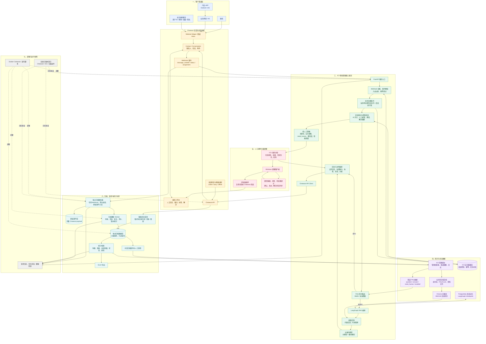

# ICS（Intelligent Customer Service）最终版项目架构图

## 总体架构

如果 Markdown 预览中的 Mermaid 图显示过小，请打开[可缩放版架构图](ics-final-architecture.html)。该页面支持滚轮缩放、按钮缩放、拖拽平移，并提供总览、实时接待链路、归档统计链路三个视图。



## 主链路说明

```text
客户从微信、APP 或 H5 进入
  -> Chatwoot 创建或复用 Contact / Conversation
  -> Chatwoot Webhook 投递用户消息
  -> ICS 完成验签、过滤、幂等登记并入队
  -> 判断当前会话是否已人工接管
  -> 判断是否需要转人工
  -> FAQ 命中则直接回复
  -> FAQ 未命中则进入 LangGraph RAG
  -> ICS 通过 Chatwoot API 回复客户
  -> 需要人工时执行分配、标签、备注、状态和提醒
  -> 坐席在 Chatwoot 工作台继续接待
  -> 会话解决后结束当前轮次
```

## 数据与运营链路

```text
Chatwoot Webhook
  -> 独立归档接收器
  -> 原始事件库
  -> 异步解析 Worker
  -> 消息 / 会话 / 轮次 / 评价 / 分配 / 状态索引
  -> 对话查询、人工质检、坐席状态监管、统计报表和 Excel 导出
```

## 组件职责边界

| 组件 | 主要职责 | 不承担的职责 |
| --- | --- | --- |
| Chatwoot | 联系人、会话、Inbox、坐席工作台、人工消息、基础状态和会话展示 | AI 问答策略、企业统计口径、独立归档和业务知识维护 |
| ICS 核心服务 | Webhook 接入、AI 首接、FAQ/RAG、会话状态、转人工和 Chatwoot API 编排 | 重新实现完整坐席工作台 |
| 管理后台 | FAQ、知识库、渠道资料、日志、归档、质检和统计入口 | 直接暴露 Chatwoot 管理凭据 |
| 提醒客户端 | 转人工强提醒、声音、置顶弹窗、浏览器会话跳转和确认 | 修改 Chatwoot 分配结果或替代坐席登录 |
| 归档接收器与 Worker | 保存原始事件、异步解析、生成可查询索引 | 参与实时 AI 回复决策 |
| 归档/统计模块 | 历史查询、质检、状态监管、询盘和坐席指标 | 影响在线会话处理结果 |

## 当前部署形态

- `ics-agent`：FastAPI、Webhook、FAQ/RAG、会话控制、管理后台和状态采样。
- `quality-receiver`：接收 Chatwoot 账户级归档 Webhook，只写原始事件和持久化任务。
- `quality-worker`：异步解析原始事件，生成消息、轮次、评价和查询索引。
- `postgres`：ICS 业务数据库，保存会话控制、幂等状态、任务状态和会话记忆。
- `archive-postgres`：独立归档数据库，按接收、解析、查询、状态采样和质检职责分级授权。
- Chatwoot：独立部署，向 ICS 提供业务 Webhook，向归档接收器提供专用账户级 Webhook。
- Windows 提醒客户端与浏览器插件：部署在客服电脑，连接 ICS 并复用客服浏览器中的 Chatwoot 登录态。

## 关键设计原则

1. Chatwoot 保留为会话与坐席底座，差异化能力放在 ICS 外部服务。
2. 转人工是一个包含状态、分配、标签、备注、提醒和公开提示的幂等动作。
3. 实时 AI 处理链路与历史归档、质检、统计链路隔离。
4. 前端和提醒客户端不持有 Chatwoot 管理端 Token。
5. 所有统计指标以归档证据、成功分配时间、公开回复和分钟状态采样为依据。
