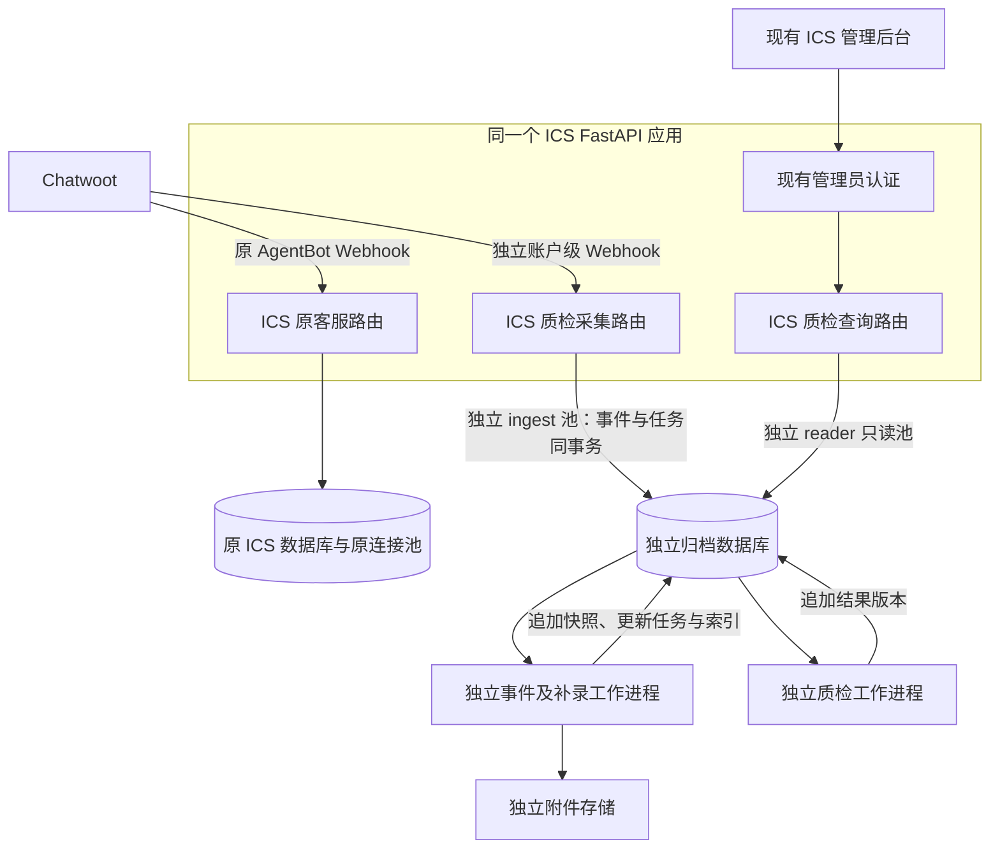

# ICS 质检模块现状分析与开发计划

日期：2026-10-15。基于当前工作区代码与现有文档分析；运行验证使用 `C:\Users\lenovo\Anaconda3\envs\cs\python.exe`（Python 3.10.21）。本次仅新增规划文档，未修改业务代码、数据库、运行配置或 Chatwoot 设置。

目标：在现有 ICS 内开发质检模块，共用现有 FastAPI 应用、管理后台、管理员认证及适用的公共接口；独立管理归档数据库、连接池和任务资源。优先保证原始对话的真实性与可恢复性，并以回归与故障测试验证现有功能不受影响。

## 1. 当前项目的实际基础

| 范围 | 已有能力 | 对后续开发的意义 |
| --- | --- | --- |
| ICS 主服务 | `ics_agent/app/main.py` 统一装配 FastAPI、生命周期、后台、Chatwoot 和提醒路由 | 质检通过独立路由与生命周期组件接入此处 |
| 客服处理 | FAQ、RAG、多渠道隔离、咨询轮次、转人工、联系人静音、提醒、可选 CSAT | 保持原有处理顺序、事务和返回语义，以现有测试建立基线 |
| 管理后台 | `ics_agent/app/admin.html` 为单页后台；已有登录、渠道导航、知识库、FAQ 和日志界面 | 增加质检导航和独立页面区域，复用登录及请求封装 |
| 管理员认证 | `ics_agent/app/core/auth.py` 提供 JWT 和 `require_admin`；目前为单管理员角色 | 首版质检仅管理员使用，暂不扩展客服、主管权限体系 |
| 渠道 | `database/channels.json`、`ics_agent/channels/config.py` 维护 account/inbox 映射 | 共用配置，但归档侧未知映射必须显式标记，不能落入默认渠道 |
| 公共组件 | Chatwoot 客户端、签名纯函数、日志、模型工厂 | 复用适用代码，执行预算、超时和数据访问权限分别配置 |
| 独立归档数据库 | `docker-compose.archive.yml` 定义独立 PostgreSQL 服务和数据卷 | 已有独立存储边界，无需再建立第二套数据库方案 |
| 数据库分层 | `archive` 原始证据、`ops` 可变任务及索引、`quality` 质检结果分区 | 原始证据与可重建索引、处理状态、评分结果分开维护 |
| 迁移与权限 | `quality/database/migrations/001_capture.sql`、初始化和验证脚本 | 运行账号只能追加原始证据；后续变更新增迁移，不能改已应用的 001 |
| 接收器 | `quality/capture/` 已有验签、账号白名单、请求限额、独立连接池、原始事件入库 | 已完成接收基础，不应重新实现另一套采集链路 |

**当前进度是“建库 + 原始事件接收基础”，尚未形成可用的质检业务闭环。**

现有接收器保存原始请求字节 `raw_body`、JSONB、数据库生成的 SHA256、来源及接收时间，并在同一事务中插入 `archive.events` 与 `ops.event_jobs`；提交成功才返回新事件 202，重复事件返回 200。它没有按机器人业务条件过滤 outgoing、人工、机器人、私密消息或活动消息。

但 `quality/capture/app.py:create_app` 当前创建的是**第二个 FastAPI 应用**，由可选 `quality-receiver` 进程监听 3010。ICS 主应用尚未挂载它，尚未完全满足“共用现有 FastAPI 实例”的要求。

以下内容只有表结构或约定，尚无完整业务实现：

- 事件任务消费、消息/会话快照解析与会话查询索引维护。
- 附件文件独立保存与校验。
- 历史及遗漏对话补录。
- 后台对话查询接口和页面。
- 质检规则、模型评分、结果版本及人工复核。

仓库状态不能证明服务器已应用迁移、已启用 Webhook 或已配置备份；这些属于首阶段部署核对项。部分旧数据库文档仍把接收器列为下一步，需要随集成同步阶段说明。

## 2. 直接影响方案的发现

### 2.1 机器人入口不能承担全量归档

现有 `POST /webhooks/chatwoot` 在业务过滤后才登记幂等和排队。`ics_agent/app/chatwoot/routes.py` 中的 `_should_process_webhook_event` 会跳过 outgoing 及部分内容类型，因此该队列不包含完整对话。

机器人幂等表只保留处理元数据、摘要和结果，并有清理逻辑；业务任务队列是内存队列。它们与 RAG 对话记忆均不适合作为永久原始记录。归档继续使用独立的账户级 Webhook 和现有 `/quality/webhooks/chatwoot`，不要替换 AgentBot 入口，也不要把全量事件送入机器人处理链。

### 2.2 “收到后持久化”与“消息全部送达”是两个保证

`quality/capture/README.md:103` 记录：此前检查的本地 Chatwoot 账户级 Webhook 会记录并吞掉投递错误，不能依赖接收端 503 自动触发源端重投。本轮没有访问实际 Chatwoot 源码或服务器，需核对实际部署版本。

如果目标是中断期间也不漏原文，必须验证并补齐源端持久化投递与重试：保留事件生成时的载荷，失败后重试并支持运维重放。接收端继续坚持落库后确认。重试时需要生成有效时间戳和签名，不能反复发送已经超过验签窗口的旧签名。

普通 API 补录只能获取源端仍存在的内容，无法找回首次接收前已被编辑或删除的原文。因此，补录用于查漏与恢复，不能替代原始事件的可靠投递。实际版本的编辑、删除、附件及私密消息事件覆盖也必须通过真实会话验证，不能只依据订阅名称推断。

### 2.3 独立池不等于完全资源隔离

`ics_agent/faq/repositories.py:96` 的业务连接池有类级共享状态，简单再实例化一次仍会复用原业务池。质检应沿用 `quality/capture/repository.py` 自有池的方向，为查询再提供 reader 只读池，不能照搬 reminder 默认复用业务池的方式。

现有接收器使用默认线程池执行同步数据库操作。接入主应用后，要提供有界的专用执行资源及等待超时，避免占满客服所用线程；也可在明确评估后采用独立异步池。事件解析、附件下载、补录和评分放在独立工作进程中，仍使用同一项目与 cs 环境，不在 HTTP 请求内执行。

共用同一 FastAPI 仍共享进程、事件循环、CPU、内存和宿主机资源。因此“不影响现有功能”要靠开关、限额、故障降级、压力测试和回滚验收落实，不能仅凭架构宣称绝对隔离。

### 2.4 当前发布链已经存在耦合

`deploy/server/release.sh:55` 无条件先执行归档数据库迁移和验证，失败会阻止后续 ICS 发布；启用 `--with-receiver` 时，接收器健康检查失败也会阻止 ICS 更新。

需要把发布目标明确区分为 ICS、quality 和联合发布：质检变更仍需先验证迁移，但单独修复或回滚 ICS 应有不依赖归档库健康的路径。不能简单忽略迁移错误后继续启动需要新表的质检功能。

### 2.5 共用应用需要同步调整配置与启动方式

- `docker-compose.yml:47` 当前将归档 ingest、quality 密码和签名 Secret 对 ICS 置空。共享接收路由后，仅向 ICS 增加采集和查询所需的最低权限配置；归档管理凭据继续不进入应用，评分凭据只给评分工作进程。
- 当前采集 `CaptureSettings` 强制校验凭据，`repository.open()` 失败会阻止采集应用启动。合并后必须延迟解析可选配置，并把质检不可用状态限制在质检组件内。
- 原采集器也使用 `/health`，并入主应用后使用独立 `/quality/health`，保留 ICS 原 `/health` 行为。
- `docker-compose.override.yml` 仅挂载、监听 `ics_agent`、`reminder`，后续需补充 `quality`；直接使用 cs 环境开发时也应监听该目录。

## 3. 推荐的目标结构

共享的是应用入口、账号与界面、渠道配置和公共代码。数据库池、事务、工作任务、外部请求预算、健康状态独立。

建议按职责在现有 `quality/` 内逐步增加生命周期、查询、事件处理、附件、补录和评分代码；主应用只做路由注册和启停装配。不要为此大范围重构现有 Chatwoot 路由、RAG 或后台页面，也不需要为首版另引入 Redis/Celery，优先利用已建好的持久化任务表。

数据约束：

1. **原始事件只追加。** 使用现有来源、账号、事件类型和原始字节摘要去重；相同载荷重投不重复建事件，内容改变应作为新的观察版本保存。这个键不是每次 HTTP 投递的审计编号。
2. **逻辑消息与快照分开。** 消息身份为 `source_key + account_id + message_id`；修改、删除和补录产生新观察，不覆盖旧正文，也不能把多个版本统计成多条消息。
3. **索引允许更新，历史不能更新。** `ops.conversation_index` 是派生数据，可重建；不能拿它替代历史证据。
4. **保留时间与来源。** 区分源端时间、接收时间、处理时间、webhook 与 backfill。补录时看到的当前版本不能标成最初发送原文。
5. **未知映射仍保留。** 保存 source/account/inbox 原值，标记渠道未映射，供管理员后续处理。
6. **附件校验实际文件。** 链接只是来源信息，独立复制并核对字节后才追加成功记录。
7. **评分只能引用证据。** 规则、模型和人工结论不得修改原始对话；新评估追加新版本。

这里的 append-only 由运行账号权限落实；高权限维护账号仍能维护数据库，SHA256 用于字节一致性检查。数据库备份和恢复演练仍需独立配置。

## 4. 分阶段开发与验收

### 阶段 0：固定基线和隔离边界

工作：

- 记录现有配置、路由、启停、发布流程及测试结果；核对目标部署的归档迁移版本和角色权限。
- 先修正测试对真实 Inbox 编号的依赖，使用受控测试渠道配置；保留业务渠道配置原值。
- 明确质检采集、查询、工作进程和评分的独立开关，默认关闭；定义限额、超时和状态。
- 补充独立发布与回滚路径，消除 ICS 发布对归档数据库的强制依赖。
- 核对实际 Chatwoot 的事件覆盖和投递失败行为，确定可靠投递实施范围。

验收：关闭质检时不要求归档凭据、不打开归档连接、不启动质检任务；现有功能与可重复的测试基线一致。

### 阶段 1：把现有采集器接入主 FastAPI

工作：

- 从 `quality/capture/app.py` 抽出可复用路由和接收服务，保持 `/quality/webhooks/chatwoot`、原始字节验签、账号限制和事务确认语义。
- 由 ICS 统一装配；质检独立初始化、超时、恢复和关闭。归档不可达或质检配置无效时，ICS 仍可启动，质检入口返回自身不可用状态并暴露告警。
- 采集池与 reader 池分开，使用独立有界执行资源；采集请求不调用模型、Chatwoot 查询或现有客服业务。
- 新增 `/quality/health`；后台可查看质检状态，原 `/health` 不增加归档数据库依赖。
- 同步环境变量最小注入、本地监听目录及需要的网关转发配置。

切换：先验证新端可用，再切换原质量 Webhook 的目标地址，核对事件流水后停旧接收器。保持同一归档库和稳定 `source_key`。同字节事件短暂双投由已有唯一键吸收；载荷重新序列化可能形成不同事件，后续消息展示仍须按逻辑消息分组。尚未启用旧端的环境可直接启用新端。

验收：客户、人工、机器人、私密消息与所需状态事件进入归档；重复请求只产生一个事件及任务；落库失败无成功确认；质量入口不触发自动回复或转人工。断归档库、满池、慢查询时，原 ICS 请求仍可处理。

### 阶段 2：完成可靠投递和持久化事件消费

源端投递与本阶段接收能力配套实施，在宣称完整采集前完成：原始事件持久保存、有效签名重试、失败可查、断线恢复与必要的人工重放。若需修改 Chatwoot，在确认其版本后单独形成变更与回归范围，不能把这项工作隐藏在 ICS 接收代码里。

事件工作进程：

- 使用已有 `ops.event_jobs`，原子领取任务，可采用 `FOR UPDATE SKIP LOCKED`，设置租约与工作者标识。
- 保存消息、会话、发送人、私密标记、内容属性及附件元数据快照；不对正文做覆盖性清洗。
- 快照追加、附件任务创建、索引更新和任务完成在同一归档库事务内提交。
- 支持失败退避、最大尝试、失败任务重放、进程退出后租约恢复；未知事件保留原文并给出明确处理状态。
- 处理乱序：历史快照均保留，旧事件不得覆盖较新的会话索引；无法确定源端顺序时标记不确定性，不用事件自增 ID 冒充业务发生顺序。
- 监控最近接收时间、源端投递失败、队列积压、最老等待任务、重试、失败任务与处理延迟。

验收：重投、并发、工作者崩溃、事务回滚、乱序事件、原文编辑和删除均可复现；已确认事件重启后可继续处理；重放不重复创建同一快照。源端断投后恢复，可核对缺口与重放结果。

**阶段 1、2 构成首个采集里程碑：原文可追溯、处理可恢复、完整性边界已验证。**

### 阶段 3：后台原始对话查询闭环

工作：

- 新增 `/admin/api/quality/...` 路由，复用 `require_admin`，通过独立 reader 池查询，不在请求中连接 Chatwoot 拼实时对话。
- 提供按来源/账号、渠道、会话、客户、时间筛选的会话列表和消息时间线；客服维度需明确是当前负责人还是历史发送人，避免统计混淆。
- 展示来源、消息角色、私密标记、编辑/删除版本和原始事件定位；显示采集缺口或尚未解析的状态。
- 采用有界时间范围、分页、查询超时和必要索引，避免全库扫描或一次加载完整长会话。
- 在原后台新增质检导航，复用登录；页面离开时取消质检请求和轮询。消息内容转义显示，避免聊天文本作为 HTML 执行。

验收：对照 Chatwoot 测试会话检查时间线、角色、私密消息和版本；无权限不能查询；归档库故障只使质检区域不可用；原知识库、FAQ、登录和日志操作正常。

### 阶段 4：附件与历史、遗漏补录

附件工作：独立保存图片、语音、视频和文件，设置下载超时、大小、并发及允许来源；记录原始链接、存储位置、字节数和 SHA256；失败重试和链接失效可见。附件存储及数据库配套备份，实际复制成功前不显示“已归档”。

补录工作：复用 Chatwoot 客户端的适用只读能力，补充分页和检查点；通过 `ops.backfill_jobs` 限速、续跑、去重并定期对账。标记补录来源和观察时间，不覆盖实时原始记录。补录结果不能还原源端已经丢失的历史版本。

验收：附件链接失效后已有归档副本仍可读；任务中断后能续跑；实时采集与补录并发不互相覆盖，且不挤占客服 API 请求预算。附件保存与首轮补录可在阶段 2 后并行推进，后台先呈现复制状态。

### 阶段 5：质检规则、模型评估与复核

先明确业务口径：质检对象是会话、咨询轮次还是人工接待段；AI 与人工分别如何评价；评分项、证据要求、严重程度、抽检范围、每日窗口、预算及复核方式。

在此基础上新增迁移和实现：

- `quality` 分区保存规则版本、任务输入范围、评估结果和人工复核版本；对应可变任务状态另建 `ops` 表并按表授权。
- 每项结论关联具体消息或快照证据，保存模型、提示词、规则和输入版本；重新评估追加新结果。
- 复用模型调用代码，但使用独立工作进程、并发、超时、速率和预算。共享模型供应商配额时，优先保留在线客服容量。
- 现有模型工厂按模型/提供商/地址/并发配置共享进程内闸门；不能直接照用客服配置而误以为任务预算已经隔离。
- 模型异常、结构不合规或缺少证据时，记录待重试/待复核状态；不能伪造评分，也不能阻塞采集确认。

验收：同一输入可追踪所用规则与模型，结论可定位证据，人工修订不覆盖历史，模型超时不影响接收和在线接待。

### 阶段 6：灰度、故障与恢复验收

- 从一个测试 Inbox 验证，再扩至一个业务渠道，核对稳定后覆盖全部目标渠道；账户级 Webhook 真实覆盖范围需同步核对。
- 测试归档停机、池耗尽、队列积压、附件失败、源端重试、模型超时和进程重启。
- 同时施加采集、查询、补录与评分负载，比较现有客服链路延迟和错误率，设置上线前商定的回归阈值；各任务配置独立 CPU/内存、连接和并发上限。
- 演练归档数据库和附件恢复，验证索引重建、任务续跑及原文读取。
- 回滚只切换代码、开关和入口，不清空归档数据卷、不修改原始证据；未被成功确认的投递需由源端队列继续重试。

验收：原客服能力通过回归和故障验证；采集缺口可定位，积压可恢复，备份可还原，单独回滚质检不要求回滚业务数据库。

## 5. 本轮验证结果及限制

使用指定 cs 环境运行现有 `tests` 与 `quality/tests` 的非真实数据库测试，最终结果：**224 passed、6 failed，另有 200 个通过的子测试**。存在第三方弃用告警。

6 个失败均来自 `tests/test_channel_routes.py:90` 同一个参数化用例：测试写死 Inbox 2 对应言聊、Inbox 3 对应星盈通；当前 `database/channels.json` 实际绑定为兴聊 3、言聊 6、星盈通 7、微信 4。失败表明测试依赖了已变化的真实配置，不能仅据此判断线上渠道路由故障。后续应给测试注入固定渠道映射，不为迎合测试修改业务映射。

首次运行另有 Windows 默认测试临时目录访问错误，获得执行权限后重跑，该错误已消失。上述最终统计来自重跑结果。

本轮明确排除了 `tests/test_handoff_repository.py`、`tests/test_session_repository.py`、`quality/tests/test_capture_database.py`；没有连接或修改实际数据库，没有实际 Chatwoot 端到端联调，没有运行完整桌面客户端或浏览器插件测试，也没有测量生产负载。因此当前结果是开发前基线，不能等同于“现网所有功能已验证无影响”。

后续回归至少覆盖：后台登录与资料维护、多渠道 FAQ/RAG、咨询轮次与旧回复抑制、转人工分配/重试、静音、提醒、CSAT、原 Webhook 签名与幂等、质检开关关闭及归档故障隔离。真实数据库测试须在隔离测试库执行。

## 6. 建议的实施拆分

| 批次 | 交付物 | 进入下一批前的条件 |
| --- | --- | --- |
| A | 回归基线、可选配置、独立发布、共享 FastAPI 采集接入 | 质检关闭及断库场景下原 ICS 通过回归 |
| B | 源端可靠投递验证/补齐、事件工作进程、快照、索引与可恢复任务 | 对话原文可追溯，重启和重投无无法解释的缺口 |
| C | 后台查询、附件保存、历史补录与对账 | 管理员可查完整观察历史，缺失与附件失败可见 |
| D | 规则、模型评估、结果版本、人工复核 | 质检口径已明确，预算与在线客服隔离 |
| E | 多渠道灰度、压力、备份恢复和回滚演练 | 各项验收满足后正式启用 |

下一次实施建议从 **A 批**开始，并同步完成真实 Chatwoot 投递能力核对；数据库结构沿用现有基础，业务功能分小批提交与验收。
