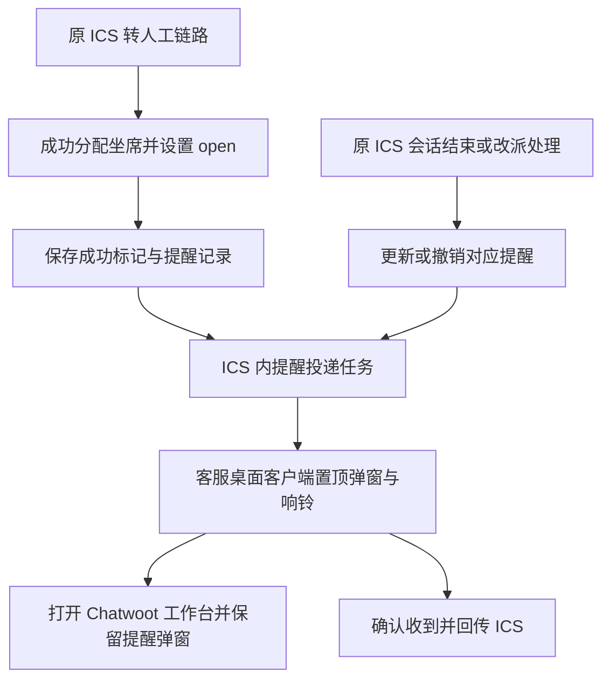

# 基于现有 ICS 的转人工桌面提醒开发计划

状态：已实现最小试验版本；下文保留完整开发规划。
更新日期：2026-10-10。  
Python 开发环境：`C:\Users\lenovo\Anaconda3\envs\cs\python.exe`。

## 1. 开发目标和目录含义

在现有 ICS 转人工功能上增加桌面提醒：ICS 成功分配客服并打开人工会话后，通知该客服电脑上的常驻程序，显示置顶弹窗、播放提示音；客服可以打开对应的 Chatwoot 会话、确认收到提醒。

**`reminder/` 是 ICS 项目中的提醒功能目录。** 开发时直接调用 ICS 已有能力，并在 ICS 现有代码中增加必要接入点。

整个功能归属于 `D:\project\CS` 的现有 Git 仓库，与 ICS 共用分支、提交、版本管理和发布流程。`reminder/` 不初始化 Git，不创建子模块或单独仓库；构建产物、缓存和凭据统一由项目根目录的 `.gitignore` 管理。桌面安装包是 ICS 的客户端交付物，也随 ICS 项目维护。

- 新增的提醒业务代码、桌面客户端、专属测试、客户端依赖及打包材料放在 `reminder/`。
- 开发文档放在 `reminder/docs/`。
- ICS 原有转人工、状态仓库、应用启动、配置和部署文件按接入需要做小范围修改，不复制到 `reminder/`。
- 服务端继续使用原 ICS 应用、端口、数据库和启动命令，不增加一套后端进程或应用入口。
- 桌面程序作为 ICS 的客户端组件运行在客服电脑上，业务判断由 ICS 完成；Chatwoot 源码无需修改。

已落地的最小版本使用原 ICS 接入点、两张增量表、真实坐席绑定和 CustomTkinter Windows 桌面客户端，通过短轮询完成提醒与确认。客户端已提供系统托盘、单实例唤醒、置顶弹窗和 PyInstaller 单文件构建；WebSocket 和完整后台恢复仍属后续规划。

## 2. 复用什么、新增什么

| 能力 | 直接复用的现有内容 | 本功能增加的部分 |
| --- | --- | --- |
| 转人工识别与分配 | `ics_agent/app/chatwoot/routes.py` 的识别、静音检查、在线判断、轮询分配和 `_complete_handoff()` | 分配成功且会话 open 后，记录坐席提醒 |
| 接管与轮次状态 | `ics_agent/app/chatwoot/state.py` 的控制记录、动作标记、结束边界 | 提醒与成功标记的事务衔接、结束时撤销提醒 |
| 数据库 | 现有 PostgreSQL 与 `PostgreSQLConnectionPool` | 通知表、设备绑定表及必要索引 |
| Chatwoot API | 现有 `ChatwootClient` / `get_chatwoot_client()` | 必要时通过原客户端补充查询，不再封装另一套 HTTP 客户端 |
| Webhook | 原 `/webhooks/chatwoot` 的验签、解析、任务队列、幂等和状态处理 | 在相关事件处理分支中联动提醒 |
| 应用与后台任务 | `ics_agent/app/main.py` 的 FastAPI 与 lifespan | 注册 reminder 路由、启动/停止提醒投递任务 |
| 配置和日志 | 原 `AppSettings`、环境变量加载、日志工具 | 少量 `REMINDER_*` 配置和提醒日志事件 |
| 权限 | 原 `require_admin` 和密码哈希工具 | 管理员吊销；独立插件登录、受限设备凭据和授权席位切换 |
| 部署 | 当前 Dockerfile、Compose、Nginx 和 ICS 启动方式 | 复制 reminder 模块、开放提醒接口和 WebSocket |
| 客服电脑界面 | 项目目前没有 | CustomTkinter 托盘程序、置顶窗口、声音、连接和本地状态 |

不另外开发组合 FastAPI 应用、ICS 状态镜像、独立 Chatwoot Webhook、管理员登录系统、通用通知平台或新的任务总线。

管理员认证继续用于设备管理与吊销；桌面客户端现使用独立的插件账号和密码，通过配置指定允许选择的 Chatwoot 席位。密码哈希能力复用 ICS，插件令牌只访问提醒功能，不扩展完整的用户、组织或权限管理系统。共享电脑可在授权席位间动态切换，具体规则见 `plugin-login-and-seats.md`。

## 3. 接入链路



### 3.1 直接在成功转人工的位置触发

在 `_complete_handoff()` 中，沿用原来的 assignment → open 顺序。Chatwoot 分配和打开会话成功后，再生成提醒；无坐席、静音、分配失败等分支不触发。通知收件人取当前人工轮次已持久保存的 `assigned_agent_id`，不能使用重试时可能为空的局部选择变量。

接入不能简单写成函数末尾的一次 WebSocket 发送：

1. 通知要先落库，发送和客户端响应由后台任务处理。
2. `handoff_conversation_updated` 的成功标记与通知插入，应在同一数据库事务中提交。扩展现有数据访问类的事务接入能力，让 `reminder/backend/repository.py` 使用调用方的同一个 cursor 写通知，不能让两个数据访问方法分别提交。
3. 事务内锁定并核验当前人工轮次、坐席和结束状态。旧任务不能为已结束或新一轮会话创建提醒。
4. 原 `handoff_action_retry` 只检查现有五个动作标记。启用提醒时，恢复逻辑还需检查该轮通知是否已保存；原动作已完成但缺通知时，只补通知，不重新分配或重复客户提示。不能先把所有动作标记完成再忽略通知写入错误。
5. 启动及低频恢复时，补齐生效范围内仍有效的缺失提醒；日常触发由业务接入点直接完成，不轮询发现每一次转人工。

通知表自身保存待投递状态即可，无需独立 outbox 表和额外消息系统。客户端掉线或 WebSocket 发送失败不会阻塞转人工。若成功标记与通知的本地事务失败，则按原有接管重试机制恢复，明确记录失败；不能声称通知已保存。现有有限队列重试耗尽后的有效接管，由恢复任务补偿。

首次上线默认覆盖功能启用后的转人工，生效时间应持久配置并在重启后保持；上线前积压需要显式选择补发范围，避免把已处理的历史会话全部弹出。已经确认、关闭或撤销的同轮通知不能因恢复而复活。

提醒功能关闭时，按原 ICS 流程执行，不要求客户端在线。启用时初始化提醒表必须早于转人工后台任务接收工作；初始化失败明确显示不可用并告警，不能悄悄报告提醒功能正常。

### 3.2 复用会话结束和改派处理

- 在现有 resolved、静音释放、状态核对等人工接管结束路径中，撤销对应轮次的提醒。优先在同一状态事务中更新，并保留现有事件时间和轮次校验。
- 原 Webhook 收到会话改派信息时，调用提醒模块更新收件人；如事件缺少信息，通过原 `ChatwootClient` 核对当前坐席。
- 如果当前 Chatwoot 订阅不覆盖所需状态事件，调整订阅并继续指向原 ICS Webhook；以实际版本支持的事件和验签方式为准，不另建提醒专用入口。
- 启动、客户端重连及低频恢复任务检查未终结提醒，补偿漏掉的结束/改派事件。状态未知时保留待核对，不错误确认或撤销。
- 补偿任务不是另一套转人工识别、选人或分配逻辑，不改变 ICS 原有业务规则。

### 3.3 客户端只负责提醒和操作

客户端连接原 ICS，获取服务端绑定给该坐席的提醒。收到通知后显示置顶窗口和声音；“打开会话”打开对应 Chatwoot 页面，“确认收到”回传通知 ID 和分配版本。

客户端不访问数据库，不持有 Chatwoot API Token，不自行判断谁应该接单。打开会话不自动确认；确认收到不等于回复客户，也不把 Chatwoot 会话标记为已解决。

## 4. 文件规划与原代码修改范围

新增内容尽量保持精简：

```text
reminder/
  __init__.py
  README.md                     # 功能说明、运行与安装方法
  docs/
    development-plan.md         # 本文
    usage-and-deployment.md     # 管理员、客服使用及现有 ICS 部署增量
    acceptance.md               # 接口约定、验收结果和已知限制
  backend/
    __init__.py
    service.py                  # 创建、确认、结束、改派和补偿
    repository.py               # 两张增量表；复用 ICS 数据库连接能力
    routes.py                   # 注册到原 ICS 的 API 与 WebSocket
    delivery.py                 # 连接管理、投递、重试和状态同步
    devices.py                  # 坐席设备绑定及受限凭据
  client/
    __init__.py
    main.py                     # 客服电脑程序入口、界面和轮询
    icons.py                    # 运行时和 exe 图标
    instance.py                 # Windows 单实例与唤醒
    storage.py                  # 本地配置、凭据保护、待上传确认
    resources/                  # 图标和提示音
  protocol.py                   # 服务端与客户端共用的轻量数据结构
  requirements-client.txt       # CustomTkinter、pystray 和 Pillow
  tests/                        # 本功能单元及集成测试
  packaging/                    # Windows 打包配置与脚本
  build/                        # 忽略提交的构建目录
  dist/                         # 忽略提交的客户端发布包
```

需要修改的现有文件：

| 位置 | 必要修改 |
| --- | --- |
| `ics_agent/app/chatwoot/routes.py` | 成功转人工接入，状态/改派联动，保持原有重试语义 |
| `ics_agent/app/chatwoot/state.py` | 支持成功标记与提醒使用同一事务，结束状态联动；复用原数据访问类 |
| `ics_agent/app/main.py` | 注册提醒路由，初始化提醒表，管理后台任务生命周期 |
| `ics_agent/app/core/config.py` | 增加开关、重提醒间隔和连接参数，复用已有 Chatwoot 公网地址配置 |
| 现有部署文件 | 把 reminder 加入镜像/开发挂载，补充 WebSocket 代理与环境变量说明 |
| 项目根目录 `.gitignore` | 统一补充 reminder 构建产物、缓存和本地敏感文件的忽略规则 |
| 现有相关测试 | 更新接入点回归测试，确保原转人工和会话状态行为正确 |

只有确实缺少的 API 查询才扩展原 `ChatwootClient`；原数据库池、管理员认证和日志实现不复制。导入方向保持清楚：应用负责装配，reminder 调用公共基础能力；事务写入动作通过参数传入，避免 `state.py` 与 reminder 互相导入形成循环。

## 5. 最小的数据和接口增量

### 5.1 两张表

| 表 | 主要内容 |
| --- | --- |
| `reminder_notifications` | 通知 ID、账户/会话、人工轮次来源键、目标坐席、分配版本、状态版本、确认/撤销时间、投递次数和重试时间 |
| `reminder_devices` | 设备 ID、账户/坐席绑定、设备凭据摘要、启用状态和最近心跳 |

沿用 ICS 的建表/增量升级方式管理结构。通知记录同时承担重连恢复和待投递记录，第一版不增加单独人工轮次表、事件镜像表、绑定码表或独立 Webhook 入库表。

去重与状态规则：

- 人工轮次使用 `account_id + conversation_id + handoff_trigger_message_id`；旧记录缺消息 ID 时使用稳定的 `handoff_at`，两者缺失时先核对。
- 不能只按会话 ID 去重，也不能按会因 6 小时空闲变化的记忆线程 ID 去重。
- 每次改派增加分配版本。A → B → A 应通知第二次接收的 A，旧确认不能影响新版本。
- 通知状态为 `pending`、`acknowledged`、`closed`、`cancelled`。送达回执只是记录，不等于确认收到。
- `acknowledged` 停止重复提醒；`closed` 表示该提醒因会话处理状态结束；`cancelled` 表示改派等原因撤销。关闭提醒不反向关闭 Chatwoot 会话。
- 更新通知时核验当前有效轮次、坐席和版本，旧 resolved、旧确认不能撤销新的提醒。

### 5.2 挂载到现有 ICS 的接口

| 拟定接口 | 用途与认证 |
| --- | --- |
| `POST /admin/reminder/devices` | 管理员为指定坐席创建设备凭据；复用 `require_admin` |
| `DELETE /admin/reminder/devices/{id}` | 管理员吊销设备；复用 `require_admin` |
| `GET /admin/reminder/status` | 查看设备在线和待提醒情况；复用 `require_admin` |
| `GET /reminder/notifications` | 客户端读取本人当前提醒列表；校验设备凭据 |
| `POST /reminder/notifications/{id}/ack` | 当前坐席幂等确认，校验通知版本 |
| `WS /reminder/ws` | 推送状态变化、心跳和回执；校验设备凭据 |

每个坐席默认允许最多 3 台有效插件设备。插件登录后可选择授权范围内的席位，使用同一设备凭据动态切换；服务器核验真实席位、授权范围和绑定版本。达到配置上限后，新绑定或切换会按最后心跳和创建时间吊销最旧插件设备。随机设备凭据服务端保存摘要，客服端以受 Windows 用户保护的方式保存。客户端不保存插件密码，不持有管理员账号或 Chatwoot API Token。旧管理员绑定设备不自动获得切换权限。

继续使用原 ICS 地址，生产连接使用 HTTPS/WSS，凭据走认证头。打开会话复用现有 `chatwoot_public_base_url` 配置，校验地址范围，避免使用容器内部 API 地址。

## 6. 桌面行为和可靠性

- **置顶弹窗：** CustomTkinter 桌面窗口，支持多条提醒合并列表，展示客户名称/摘要、等待时间和操作按钮。
- **声音：** 首次到达播放短提示音，未确认时默认每 30 秒再次提醒，间隔可配置。
- **托盘：** 展示连接状态，提供测试提醒、打开窗口、退出和可取消的开机自启。关闭窗口只收起，不视为确认收到。
- **确认：** 先在本机停止重复响铃，再回传服务器；离线时标记“确认待同步”，恢复后校验版本再提交。
- **同步：** WebSocket 可只推送“状态已变化”，客户端串行读取完整当前列表并替换本地状态；连接建立及周期心跳时也同步，避免丢失撤销。完整同步成功前不能因网络错误清空提醒。
- **恢复：** 服务端从持久记录恢复有效 pending 通知；客户端按通知 ID 和版本去重。重复推送不能产生多个窗口，已结束或改派的提醒不补弹。
- **资源：** 复用现有数据库池和网络能力，提醒任务设超时与并发上限；桌面网络请求不阻塞界面。

桌面置顶覆盖普通软件切换场景，不保证覆盖锁屏、UAC 安全桌面或独占全屏，也不强制抢键盘焦点。睡眠恢复后先重新同步。声音是否可听见受电脑音量和设备状态影响，客户端提供测试功能。

## 7. 开发步骤

### 步骤 1：确定最小接入点和一期范围

- [ ] 核对当前 `_complete_handoff()`、状态释放及原 Webhook 重试路径。
- [ ] 确定第一版功能：定向提醒、置顶响铃、打开会话、确认收到、结束/改派撤销、重连补发、设备在线状态。
- [ ] 在 ICS 现有 Git 仓库内建立 reminder 功能目录，所有 Python 开发使用指定 `cs` 环境，沿用项目根目录的忽略规则。
- [ ] 确认实际 Chatwoot 的会话事件覆盖、坐席信息和浏览器会话地址。

产出：原代码接入清单和本功能接口约定，不创建新的后端应用。

### 步骤 2：实现通知记录并接入原转人工事务

- [ ] 复用 PostgreSQL 连接池，建立通知表和设备表。
- [ ] 在原会话数据访问类中提供必要的同事务接入能力，在成功标记提交时写通知。
- [ ] 实现当前轮次校验、通知唯一约束和分配版本。
- [ ] 在原接管结束路径中撤销对应提醒。
- [ ] 增加启动和低频补偿，补齐仍有效的缺失提醒，处理原有限重试耗尽的情况。

验收：无可用坐席、静音、转接未成功时不提醒；同一触发重试不重复；本地写入失败能恢复；新的人工轮次可再次提醒。

### 步骤 3：接入现有 ICS 路由、认证和生命周期

- [ ] 将 reminder 路由注册到原 FastAPI，沿用现有启动命令。
- [ ] 在原 lifespan 中初始化表并启动/停止投递任务。
- [ ] 复用 `require_admin` 提供设备创建、吊销和状态查看。
- [ ] 实现仅限本人提醒的设备凭据校验、WebSocket、列表和确认接口。
- [ ] 配置开关和日志沿用现有配置体系。

验收：原 ICS 接口正常，A 坐席不能读取或确认 B 的通知，被吊销设备不能继续接收。

### 步骤 4：开发 Windows 提醒客户端（最小版本已完成）

- [x] 使用 CustomTkinter 实现托盘、单实例、连接设置和设备凭据保存。
- [x] 实现置顶弹窗、多条待处理列表、提示音及重复提醒。
- [x] 实现打开会话、确认收到、关闭收起和连接状态。
- [ ] 实现断线重连、完整状态同步、本地去重和离线确认补交。
- [x] 提供提醒测试和 PyInstaller 单文件构建；开机自启暂不加入安装向导。

验收：切换到其他普通桌面软件后仍可看到提醒；断网状态可见；恢复后不出现已结束的旧弹窗。

### 步骤 5：完成原 Webhook 的状态联动

- [ ] 复用原事件入口、签名校验、去重和任务处理，接入结束与改派提醒更新。
- [ ] 对缺少状态/坐席的事件，通过原 `ChatwootClient` 核对。
- [ ] 覆盖 A → B → A、移除坐席、旧事件晚到、resolved 后再次转人工。
- [ ] 投递、确认及补发时校验当前轮次和分配版本，防止状态竞态。

验收：结束后撤销提醒，改派只通知当前坐席，旧确认和旧事件不影响新通知。

人工回复自动止铃作为后续小扩展：原入口目前过滤 outgoing，启用时在原入口增加提醒专用分支并复用原幂等，不能进入 AI 回答链路。ICS 可能使用普通用户 API Token 发机器人消息，所以 `sender.type = User` 不足以证明真人；必须验证可靠的来源标记，并排除机器人提示、自动化消息、私密备注及旧分配下的回复。未验证前使用“确认收到”和会话结束止铃。

### 步骤 6：联调与回归测试

- [ ] 新功能测试放在 `reminder/tests/`，并更新已有接管接入点的回归测试。
- [ ] 验证事务提交前后崩溃、五个动作标记完成后的恢复、服务重启、断线和重复通知。
- [ ] 验证数据库/API 短时失败、关闭与通知并发、改派后旧确认、权限隔离。
- [ ] 复测原 ICS 的转人工、AI 静默、resolved 和静音处理。
- [ ] Windows 真机验证普通软件切换、多显示器、显示缩放、睡眠恢复及声音。
- [ ] 健康环境以成功标记提交到弹窗显示的 95% 延迟不超过 3 秒为验收目标，记录实测环境与结果。

测试使用隔离数据与模拟业务事件，不向生产会话发送测试消息。

### 步骤 7：打包、部署和文档交付

- [x] 桌面依赖放在 `reminder/requirements-client.txt`，服务器不安装桌面依赖。
- [x] 用 PyInstaller 打包 Windows 程序，在当前 Windows 环境验证启动。
- [ ] 对原 Dockerfile/Compose 做必要增量，确保打包 reminder；补充原代理的 WebSocket 和提醒路径配置，管理员接口继续受限开放。
- [ ] 在原 ICS 环境配置中增加提醒开关和间隔，先绑定一个坐席灰度验证。
- [ ] 提供设备安装/绑定、测试提醒、掉线排查、吊销和关闭功能的说明。
- [ ] 开关关闭时停止提醒投递并通知/断开客户端，由客户端停止已停用功能的响铃；转人工继续按原逻辑运行，通知数据保留以供核查。

产出：原 ICS 的小范围接入修改、`reminder/` 下的提醒模块与客户端、Windows 发布包、使用部署说明和验收记录。

## 8. 交付标准

1. 使用现有 ICS 即可触发提醒，无需启动第二套后端或重复配置数据库和 Chatwoot 接入。
2. 成功转人工只通知当前坐席；在其他普通软件前可见置顶提醒，支持响铃、打开会话和确认收到。
3. 重试、重启和断线后状态正确，结束或改派的通知不反复出现。
4. 客户端故障不阻塞原转人工；持久化故障有明确失败与恢复路径。
5. 现有可复用能力保留在 ICS 中；reminder 只包含新增提醒功能、客户端和相关材料。
6. 原 ICS 接入点回归通过，提供可安装客户端、部署增量说明和真机验收记录。
7. 全部变更纳入 ICS 现有 Git 仓库和项目流程，reminder 仅作为功能目录管理。
